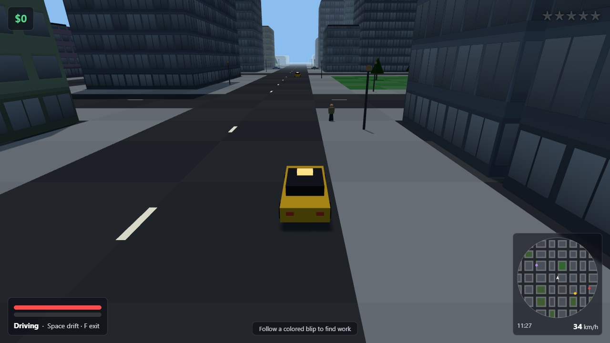
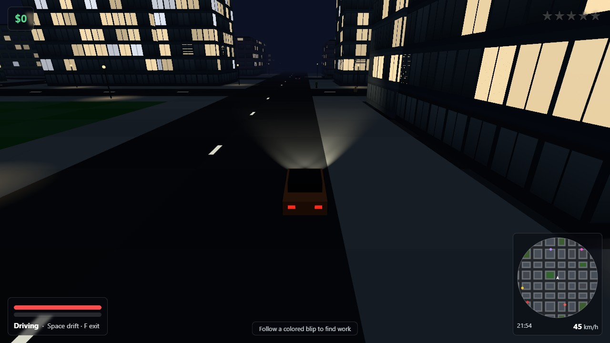

# Overdrive City

A 3D open-world driving game that runs in the browser: take any car in a procedurally generated city, pick up jobs, and shake off the police through a full day-night cycle.

**Play it: <https://appleweiping.github.io/overdrive-city/>** (desktop browser, keyboard and mouse)


I built it to see how much of an open-world game fits in plain JavaScript
with no build step: the only dependency is a vendored copy of Three.js, and
everything else (the city, the cars, the people, the sound) is generated by
the code in `src/`. It is the 3D follow-up to my earlier top-down prototype,
[hotwire-city](https://github.com/appleweiping/hotwire-city).

| Day | Night |
|---|---|
|  |  |

## Run it locally

ES modules need a web server (opening `index.html` from disk will not work):

```bash
git clone https://github.com/appleweiping/overdrive-city.git
cd overdrive-city
python -m http.server 8000
# open http://localhost:8000 and click "CLICK TO DRIVE"
```

There is nothing to install and nothing to build. Any WebGL2 browser works;
on a phone the title screen explains that you need a keyboard and mouse.

With Node 22 or newer, `node --test test/city.test.mjs` checks without a
browser that every module loads and that the seed still builds the same
connected city. CI runs it on every push.

## Controls

| On foot | |
|---|---|
| `W` `A` `S` `D` | Move (relative to the camera) |
| `Shift` | Sprint |
| Mouse | Look and aim |
| Left click | Punch / shoot |
| `1` `2` `3`, `Q` | Fists, pistol, SMG / next weapon |
| `F`, `E` or `Enter` | Get into the nearest car (the driver gets thrown out) |

| Driving | |
|---|---|
| `W` / `S` | Throttle / brake and reverse |
| `A` / `D` | Steer |
| `Space` | Handbrake (drift) |
| `F` or `E` | Get out (below about 30 km/h) |

`M` mutes, `Esc` or `P` pauses, and clicking the game captures the mouse again.

## What you do

Coloured beacons around the map offer ten kinds of generated jobs: timed
deliveries, multi-stop runs, taxi fares (ROGUE CAB), a quiet delivery that pays
double if you never pick up a wanted star and fails at three (GHOST RUN),
checkpoint races, drift contracts, delivering a stolen car undamaged, a getaway
that starts with the police already on you, holding a street corner against
waves of armed gang members, and a guarded bounty. Rewards scale with distance,
how wanted you are and the time of day. The clock starts at 08:24 and runs a
full day every eight minutes.

Crimes build heat, and every 20 heat adds a wanted star (up to five). Officers
arrive on foot, then in cruisers, and from three stars the cruisers ram you.
Heat only drains once no officer has had line of sight to you for four seconds,
so you lose them by breaking line of sight, not by waiting. If you stand still
next to an officer you get **CUFFED** (−20% cash); if you die you are
**FLATLINED** (−30%). Pay from the car theft, holdout and bounty jobs only
lands once you have lost the heat. Your cash is the score, and the best run is saved in the browser.

Civilians are never targets and only run away; everyone you are paid to fight
is armed. There is no gore.

## How it's built

- **One tile map runs the world.** `src/city.js` generates a 96 × 96 tile grid (8 m tiles, a 768 m square city) from a fixed seed in `src/config.js`. The same array is used for collision, police line of sight (a DDA ray march over tiles), traffic lanes and mission placement; there is no physics engine or navmesh.
- **Drifting is one parameter.** `src/vehicle.js` splits each car's velocity into forward and sideways parts and decays the sideways part by `exp(−grip·dt)`. The handbrake just swaps in a much lower grip; the slide, skid marks and drift score all follow from the sideways speed.
- **Facades are drawn in code.** `src/citymesh.js` paints a small window atlas onto a canvas at startup and a patched Three.js material tiles it per building in metres, with ground-floor shopfronts downtown and a stable random pattern of lit windows at night.
- **Few draw calls.** The static city is nine meshes: one merged ground mesh plus one `InstancedMesh` per prop type (buildings, roofs, lamp posts, lamp heads, light pools, trunks, canopies, lane markings).
- **Fixed 60 Hz simulation.** `src/main.js` steps the game in 1/60 s increments with an accumulator, so handling feels the same at any frame rate. Sound effects, sirens and engine noise are synthesized with the Web Audio API (`src/audio.js`).

All tuning constants (handling, heat values, police budgets, weapon stats,
mission pay) are in [`src/config.js`](src/config.js); change `SEED` for a
different city. The full tuning reference is in [docs/DESIGN.md](docs/DESIGN.md).

## Why not a game engine?

Unity, Godot or a commercial open-world game will give you far better physics,
art and content. This project is about the opposite constraint: about 3,400
lines of JavaScript, one vendored library and no assets, readable in an
afternoon and playable from a static page.

## Limitations

- No touch or gamepad controls yet.
- No traffic lights; traffic picks a legal exit at each junction and brakes for whatever is in front of it, but nobody gives way.
- One fixed city layout per seed; no water, bridges or interiors.
- Progress is only the best-run score in `localStorage`; there is no save game.

## Layout

```
index.html            page, HUD markup, import map
lib/three.module.js   Three.js r160 (vendored, unmodified)
src/config.js         every tuning constant
src/city.js           tile map, districts, buildings, lanes, line of sight
src/citymesh.js       instanced city meshes and the facade shader
src/daynight.js       sun, fog and sky keyframes
src/vehicle.js        driving model, damage, car-to-car collisions
src/traffic.js        lane-following traffic, parked cars, carjacking
src/peds.js           civilians, police and gang members
src/police.js         heat, stars, line-of-sight decay, escalation, arrests
src/missions.js       the job framework and the ten job types
src/player.js, weapons.js, effects.js, audio.js, hud.js, minimap.js, input.js, main.js
test/city.test.mjs    module loading and city generation checks for Node
```

## License

MIT, see [LICENSE](LICENSE). Three.js is MIT-licensed by its authors. The game
is inspired by the open-world driving games of the 2000s but uses no code,
art, names or audio from them and is not affiliated with any publisher.

中文说明见 [README.zh-CN.md](README.zh-CN.md)。
