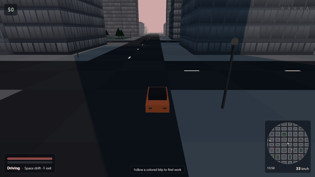

# Overdrive City（超速之城）

一个在浏览器里运行的 3D 开放世界驾驶游戏：在程序生成的城市里随便开走一辆车，接活、甩掉警察，从正午开到深夜。

**在线试玩：<https://appleweiping.github.io/overdrive-city/>**（桌面浏览器，需要键盘和鼠标）



我想看看不用构建工具、只用原生 JavaScript 能做出多少开放世界：唯一的依赖是仓库里自带的
Three.js，城市、车辆、行人和声音全部由 `src/` 里的代码生成。它是我早先的俯视角原型
[hotwire-city](https://github.com/appleweiping/hotwire-city) 的 3D 续作。

## 本地运行

```bash
git clone https://github.com/appleweiping/overdrive-city.git
cd overdrive-city
python -m http.server 8000
# 打开 http://localhost:8000
```

ES 模块需要通过 http 访问，直接双击 `index.html` 打不开。无需安装、无需构建。

## 操作

| 步行 | |
|---|---|
| `W` `A` `S` `D` | 移动（相对镜头） |
| `Shift` | 冲刺 |
| 鼠标 / 左键 | 视角与瞄准 / 出拳、射击 |
| `1` `2` `3`、`Q` | 拳头、手枪、冲锋枪 / 切换武器 |
| `F`、`E` 或 `Enter` | 上最近的车（有司机会被拽下来） |

| 驾驶 | |
|---|---|
| `W` / `S` | 油门 / 刹车与倒车 |
| `A` / `D` | 转向 |
| `Space` | 手刹（漂移） |
| `F` 或 `E` | 下车（约 30 km/h 以下） |

`M` 静音，`Esc` 或 `P` 暂停。

## 玩法

地图上的彩色光柱是十类随机生成的任务：限时送货、多点配送、拉客（ROGUE CAB）、
检查点竞速、漂移挑战、偷指定车辆、开局就被通缉的逃亡、守街角、悬赏目标等。

犯罪会积累热度，每 20 点热度加一颗通缉星（最多五颗）。只有离开所有警察视线 4 秒后
热度才会下降，所以要靠躲开视线而不是干等。站着不动被警察贴身会被 **CUFFED**（现金 −20%），
死亡则是 **FLATLINED**（−30%）。平民永远不是目标，只会逃跑；没有血腥画面。

## 实现要点

- `src/city.js` 用固定种子生成 96 × 96 的瓦片地图（768 m 见方），碰撞、警察视线、车道和任务落点都用这一个数组。
- `src/vehicle.js` 把速度拆成纵向和横向，横向按 `exp(−grip·dt)` 衰减；手刹只是换一个更小的抓地系数。
- `src/citymesh.js` 在启动时用 canvas 画一张窗户图集，由改写过的 Three.js 材质按米为单位铺到每栋楼上，夜里随机亮灯。
- 静态城市只有 9 个网格：一个合并的地面网格，加每类物件一个 `InstancedMesh`。
- 固定 60 Hz 仿真步长；音效全部用 Web Audio 实时合成。

调参常量都在 [`src/config.js`](src/config.js)，详细说明见 [docs/DESIGN.md](docs/DESIGN.md)。

## 许可

MIT。灵感来自 2000 年代的开放世界驾驶游戏，但没有使用它们的代码、美术、名称或音频，
与任何发行商无关。
